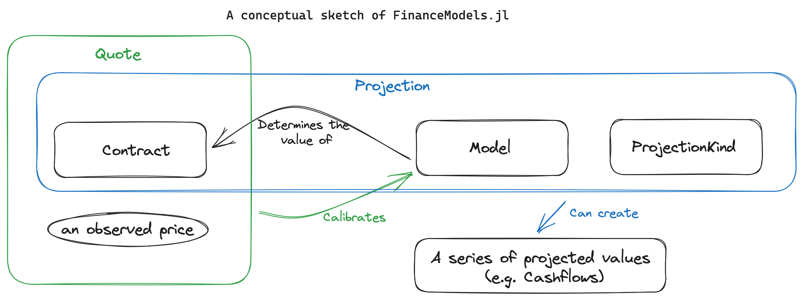

# FinanceModels.jl Guide

**FinanceModels.jl** provides a set of composable contracts, models, and functions that allow for modeling of both simple and complex financial instruments. The resulting models, such as discount rates or term structures, can then be used across the JuliaActuary ecosystem to perform actuarial and financial analysis.



## 1. `Cashflow` - a fundamental financial type

Say you wanted to model a contract that paid quarterly payments, and those payments occurred starting 15 days from the valuation date (first payment time = 15/365 = 0.057)

Previously, you had two options:

1. Choose a discrete timestep to model (e.g. monthly, quarterly, annual) and then lump the cashflows into those timesteps. E.g. with monthly timesteps  of a unit payment of our contract, it might look like: `[1,0,0,1,0,0...]`
2. Keep track of two vectors: one for the payment and one for the times. In this case, that might look like: `cfs = [1,1,...];`times = `[0.057, 0.307...]`

The former has inaccuracies due to the simplified timing and logical complication related to mapping the contracts natural periodicity into an arbitrary modeling choice. The latter becomes unwieldy and fails to take advantage of Julia's type system.

The new solution: `Cashflow`s. Our example above would become: `[Cashflow(1,0.057), Cashflow(1,0.307),...]`

## 2. **Contracts** - A composable way to represent financial instruments

Contracts are a composable way to represent financial instruments. Many contracts project to a collection of cashflows; others, such as options, use a model-specific pricing formula. Contracts can be combined to represent more complex instruments. For example, a bond can be represented as a collection of cashflows that correspond to the coupon payments and the principal repayment.

Examples:

- a `Cashflow`
- `Bond`s:
  - `Bond.Fixed`, `Bond.Floating`
- `Option`s:
  - `Option.EuroCall` and `Option.EuroPut`
- Compositional contracts:
  - `Forward` to represent an instrument that is relative to a forward point in time.
  - `Composite` to represent the combination of two other instruments.  

In the future, this notion may be extended to liabilities (e.g. insurance policies in LifeContingencies.jl)

### Creating a new Contract

A contract with deterministic cashflows can define how it is collected into `Cashflow`s. For example, let's create a bond which only pays down principal and offers no coupons.

```julia
using FinanceModels,FinanceCore

# Transducers is used to provide a more powerful, composable way to construct collections than the basic iteration interface
import Transducers
using Transducers: __foldl__, @next, complete

"""
A bond which pays down its par (one unit) in equal payments. 
"""
struct PrincipalOnlyBond{F<:FinanceCore.Frequency} <: FinanceModels.Bond.AbstractBond
    frequency::F
    maturity::Float64
end

# We extend the interface to say what should happen as the bond is projected
# There's two parts to customize:
# 1. any initialization or state to keep track of
# 2. The loop where we decide what gets returned at each timestep
function Transducers.__foldl__(rf, val, p::Projection{C,M,K}) where {C<:PrincipalOnlyBond,M,K}
    # initialization stuff
    b = p.contract # the contract within a projection
    ts = Bond.coupon_times(b) # works since it's a FinanceModels.Bond.AbstractBond with a frequency and maturity
    pmt = 1 / length(ts)

    for t in ts
        # the loop which returns a value
        cf = Cashflow(pmt, t)
        val = @next(rf, val, cf) # the value to return is the last argument
    end
    return complete(rf, val)
end
```

We can now use this contract to fit models, create projections, quotes, etc. Here we simply collect the bond into an array of cashflows:

```julia-repl
julia> PrincipalOnlyBond(Periodic(2),5.) |> collect
10-element Vector{Cashflow{Float64, Float64}}:
 Cashflow{Float64, Float64}(0.1, 0.5)
 Cashflow{Float64, Float64}(0.1, 1.0)
 Cashflow{Float64, Float64}(0.1, 1.5)
 Cashflow{Float64, Float64}(0.1, 2.0)
 Cashflow{Float64, Float64}(0.1, 2.5)
 Cashflow{Float64, Float64}(0.1, 3.0)
 Cashflow{Float64, Float64}(0.1, 3.5)
 Cashflow{Float64, Float64}(0.1, 4.0)
 Cashflow{Float64, Float64}(0.1, 4.5)
 Cashflow{Float64, Float64}(0.1, 5.0)
```

The built-in bond contracts use unit principal. Scale their projected cashflows for a position's notional; individual `Cashflow`s can carry any amount.

#### More complex Contracts

**When the cashflow depends on a model**. An example of this is a floating bond where the coupon paid depends on a view of forward rates. See **Section 6 - Projections** for how this is handled: the contract reads its model by key from a valuation context such as [`Models`](@ref) (see [Contracts](@ref)).

## 3. `Quote`s - The observed price we need to fit a model to

Quotes are the observed prices that we need to fit a model to. They represent the market prices of financial instruments, such as bonds or swaps. In the context of the package, a quote is defined as a pair of a contract and a price.

For example, a par yield bond paying a 4% coupon (paid as 2% twice per annum) implies a price at par (i.e. `1.0`):

```julia-repl
julia> ParYield(Periodic(0.04,2),10)
Quote{Float64, FinanceModels.Bond.Fixed{Periodic, Float64, Int64}}(
1.0, 
FinanceModels.Bond.Fixed{Periodic, Float64, Int64}(0.040000000000000036, Periodic(2), 10))

```

A number of convenience functions are included to construct a `Quote`:

- `ZCBPrice` and `ZCBYield`
- `ParYield`
- `CMTYield`
- `OISYield`
- `ForwardYield`

## 4. **Models** - Not just yield curves anymore

- **Yield Curves**: all of Yields.jl yield models are included in the initial FinanceModels.jl release
- **Equities and Options**: The initial release includes `BlackScholesMerton` option pricing with a constant volatility model (`Volatility.Constant`)
- **Others** more to come in the future

### Creating a new model

Here we'll do a complete implementation of a yield curve model where the discount factor is approximated by a straight line (an AB line, `y = ax + b`). This is a simple extension example, not a general-purpose term-structure model.

```@example custom_model
using FinanceModels, FinanceCore
using Accessors
using IntervalSets
 
struct ABDiscountLine{A,B} <: FinanceModels.Yield.AbstractYieldModel
    a::A
    b::B
end

ABDiscountLine() = ABDiscountLine(-0.05, 1.0)

function FinanceCore.discount(m::ABDiscountLine,t)
    # The discount factor is approximated by a straight line, floored at 0.0 and capped at 1.0
    clamp(m.a*t + m.b, 0.0,1.0) 
end


# `@optic` indicates what in our model variables needs to be updated (from Accessors.jl)
# IntervalSets supplies the bounds. Keep the initial guess inside them, away from clipping.
FinanceModels.default_variables(m::ABDiscountLine) = (
    @optic(_.a) => -1.0 .. 1.0,
    @optic(_.b) => 0.5 .. 1.5,
)

quotes = ZCBPrice([0.9, 0.8, 0.7,0.6])

m = fit(ABDiscountLine(), quotes)
@assert all(isapprox(pv(m, q.instrument), q.price; atol=1e-8) for q in quotes) # hide
nothing # hide
```

The separate type parameters for `a` and `b` allow fitting to update either field with a ForwardDiff dual number.

Now, `m` is a model like any of the other yield curve models provided and can be used in that context. For example, calculating the price of the bonds contained within our `quotes` where we indeed recover the prices for our contrived example:

```@example custom_model
round.([pv(m, q.instrument) for q in quotes]; digits=6)
```

## 5. `fit` - The standardized API for all models, quotes, and methods

```plaintext
       Model                                                                Method
          |                                                                    |
    |------------|                                                      |---------------|
fit(Spline.Linear(), CMTYield.([0.04,0.05,0.055,0.06,0.055],[1,2,3,4,5]), Fit.Bootstrap())
                    |-------------------------------------------------|
                                              |
                                              Quotes
```

- **Model** could be `Spline.Linear()`, `Yield.NelsonSiegelSvensson()`, `Equity.BlackScholesMerton(...)`, etc.
- **Quote** could be `CMTYield`s, `ParYield`s, `Option.EuroCall`, etc.
- **Method** could be `Fit.Loss(x->x^2)`, `Fit.Loss(x->abs(x))`, `Fit.Bootstrap()`, etc.

The benefit of this versus the old Yields.jl API is:

- Without a generic `fit` method, no obvious way to expose different curve construction methods (e.g. choice of model and method)
- The `fit` is extensible. Users or other packages could define their own Models, Quotes, or Methods and integrate into the JuliaActuary ecosystem.
- The `fit` formulation is very generic: the required methods are minimal to integrate in order to extend the functionality.

### Customizing model fitting

Model fitting can be customized:

- The **loss function** (least squares, absolute difference, etc.) via the third argument to `fit`:
  - e.g. `fit(ABDiscountLine(), quotes, Fit.Loss(x -> abs(x)))`
  - the default is `Fit.Loss(x->x^2)`
- the **optimization algorithm** by defining a method `FinanceModels.default_optimizer(m::ABDiscountLine) = OptimizationOptimJL.Newton()`
  - `Newton()` needs every variable unbounded: omit the `=>` and the bounds, as in `(@optic(_.a), @optic(_.b))`. With bounded variables the optimizer runs inside Optim.jl's `Fminbox`, which does not take `Newton()` (`IPNewton()` works there)
  - The default is `OptimizationOptimJL.LBFGS()` (polynomial, PCHIP, Akima, and B-spline least-squares fits default to `OptimizationOptimJL.Newton()`; MonotoneConvex uses `LBFGS()`)
- The **general algorithm** can be customized by defining a new `Fit.FitMethod` subtype and a method `FinanceModels.fit(model, quotes, method::YourMethod)` for it.

- As an example, the linear splines (`Spline.Linear()` and `Spline.BSpline(1)`) define a dedicated bootstrapping method which is used when `Fit.Bootstrap()` is passed explicitly: `fit(mod0::Spline.SplineCurve, quotes, method::Fit.Bootstrap)`. Note that the default `fit(spline, quotes)` (no third argument) performs a least-squares fit, not a bootstrap.

### Using models without fitting

While many of the examples show models being fit to observed prices, you can skip that step in practice if you want to define an assumed valuation model that does not intend to calibrate market prices.

## 6. `Projection`s

A `Projection` is a generic way to work with various data that you can project forward. For example, getting the series of cashflows associated with a contract.

A `Projection` holds these three fields (a schematic view of the package type):

```text
struct Projection{C,M,K} <: AbstractProjection
    contract::C    # the contract (or set of contracts) we want to project
    model::M       # the model that defines how the contract will behave
    kind::K           # what kind of projection do we want? only cashflows?
end
```

`contract` is obvious, so let's talk more about the second two:

- `model` is the same kind of thing we discussed above. Some contracts, such as floating-rate bonds, need a model to determine their projected cashflows.
  - There are also projections which don't need a model (e.g. fixed bonds) and for that there's the generic `NullModel()`
- `kind` defines what we'll return from the projection.
  - `CashflowProjection()` says we just want a `Cashflow[...]` vector
  - ... but if we wanted to extend this such that we got a vector containing cashflows, capital factors, default rates, etc we could define a new projection type (e.g. we might call the above `AssetDetailProjection()`
  - Currently, only `CashflowProjection()` is defined by FinanceModels.jl

### Contracts that depend on the model (or multiple models)

For example, a floating-rate bond's projected coupons depend on its reference curve. Or maybe you have a stochastic volatility model and want to project forward option values. This type of dependency is handled like this:

- define `model` as a relation that maps a key to a model. E.g. a `Dict("SOFR" => NelsonSiegelSvensson(...))`
- when defining the logic for the reducible collection/foldl, you can reference the `Projection.model` by the associated key.
- to value the contract, wrap the store with the discount model: `present_value(Models(curve, Dict("SOFR" => sofr)), bond)`.

Here is a simplified custom floating bond for full coupon periods. It has a distinct name so the example does not overwrite FinanceModels' built-in `Bond.Floating` implementation, which also handles stub periods.

```julia
struct ExampleFloating{F<:FinanceCore.Frequency,N<:Real,M<:Real,K} <: FinanceModels.Bond.AbstractBond
    coupon_rate::N
    frequency::F
    maturity::M
    key::K
end

function Transducers.__foldl__(rf, val, p::Projection{C,M,K}) where {C<:ExampleFloating,M,K}
    b = p.contract
    ts = Bond.coupon_times(b)
    freq = b.frequency.frequency
    isinteger(b.maturity * freq) || throw(ArgumentError("this example requires full coupon periods"))
    model = p.model[b.key]
    for t in ts
        # Project the next coupon from the index curve's interval factor.
        coupon = inv(discount(model, t - 1 / freq, t)) - 1 + b.coupon_rate / freq
        cf = Cashflow(coupon + (t == last(ts) ? 1 : 0), t)
        val = @next(rf, val, cf)
    end
    return complete(rf, val)
end

curve = Yield.Constant(0.04)
floating = ExampleFloating(0.01, Periodic(2), 3.0, "SOFR")
collect(Projection(floating, Models(curve)))
```

This projects coupons from a supplied term structure. A realized stochastic path is not a sequence of conditional term structures at the reset dates; see [Stochastic Interest Rate Models](@ref) for a fixing example based on the simulated state.

In this guide we've now defined two assets that can work seamlessly with projecting cashflows, fitting models, and determining valuations :)

## 7. `ProjectionKind`s

While `CashflowProjection` is the most common (and the only one built into the initial release of FinanceModels), a `Projection` can be created which handles different kinds of outputs in the same manner as projecting just basic cashflows. For example, you may want to output an amortization schedule, or a financial statement, or an account value roll-forward. The `Projection` is able to handle these custom outputs by dispatching on the third element in a `Projection`.

Let's extend the example of a principal-only bond from section 2 above. Our goal is to create a basic amortization schedule which shows the payment made and outstanding balance.

First, we create a new subtype of `ProjectionKind`:

```julia
struct AmortizationSchedule <: FinanceModels.ProjectionKind
end
```

And then define the loop for the amortization schedule output:

```julia
# note the dispatch on `AmortizationSchedule` in the next line
function Transducers.__foldl__(rf, val, p::Projection{C,M,K}) where {C<:PrincipalOnlyBond,M,K<:AmortizationSchedule}
    # initialization stuff
    b = p.contract # the contract within a projection
    ts = Bond.coupon_times(b) # works since it's a FinanceModels.Bond.AbstractBond with a frequency and maturity
    pmt = 1 / length(ts)
    balance = 1.0
    for t in ts
        # the loop which returns a tuple of the relevant data
        balance -= pmt
        result = (time=t,payment=pmt,outstanding=balance)
        val = @next(rf, val, result) # the value to return is the last argument
    end
    return complete(rf, val)
end
```

We can now define the projection:

```julia-repl
julia> p = Projection(
           PrincipalOnlyBond(Periodic(2),5.),  # our contract
           NullModel(),                       # the projection doesn't need a model, so use the null model
           AmortizationSchedule(),            # specify the amortization schedule output
           );

```

And then collect the values:

```julia-repl
julia> collect(p)
10-element Vector{NamedTuple{(:time, :payment, :outstanding), Tuple{Float64, Float64, Float64}}}:
 (time = 0.5, payment = 0.1, outstanding = 0.9)
 (time = 1.0, payment = 0.1, outstanding = 0.8)
 (time = 1.5, payment = 0.1, outstanding = 0.7000000000000001)
 (time = 2.0, payment = 0.1, outstanding = 0.6000000000000001)
 (time = 2.5, payment = 0.1, outstanding = 0.5000000000000001)
 (time = 3.0, payment = 0.1, outstanding = 0.40000000000000013)
 (time = 3.5, payment = 0.1, outstanding = 0.30000000000000016)
 (time = 4.0, payment = 0.1, outstanding = 0.20000000000000015)
 (time = 4.5, payment = 0.1, outstanding = 0.10000000000000014)
 (time = 5.0, payment = 0.1, outstanding = 1.3877787807814457e-16)
```
